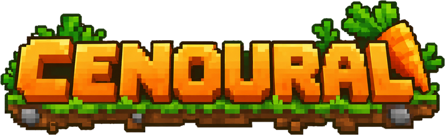

  

<h3 align="center">Cenoural</h3>

  An incremental pixel-art mining game that runs right in your browser. 
  Dig deeper, collect ores, upgrade your tools, and be reborn.

  <a href="https://yaanic.github.io/cenoural/"><b>▶ Play now</b></a>

  English · <a href="README.md">Português</a>

## Made with AI

This game was created by **João Pedro Borges** with the help of artificial intelligence ([Claude](https://claude.ai), by Anthropic). Part of the code and content was generated with AI, under the author's direction and curation.

## License

© 2026 João Pedro Borges. **All rights reserved.**

The game may be played on the official site. Copying, hosting elsewhere, modifying, selling, or reusing the code and assets is **not allowed** without the author's prior written permission. Read the [full license](LICENSE.txt) (written in Portuguese).

## Credits

- Game, design, and direction: João Pedro Borges
- AI-assisted development: Claude (Anthropic)
- Font: [Silkscreen](https://fonts.google.com/specimen/Silkscreen) by Jason Kottke, SIL Open Font License
